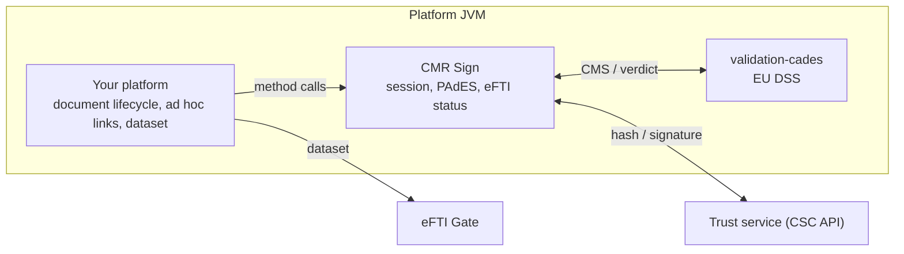

# CMR Sign

A Kotlin/JVM library and demo for signing and validating freight documents (such as CMR consignment notes) with PAdES and EU DSS. The signing key stays with a trust service behind the `SigningProvider` seam.

> **Status:** prototype, 0.3.0. Signs and validates end to end with a development identity and with SSL.com's CSC sandbox. Output is **not a legally valid eIDAS signature** unless the certificate comes from a provider on an EU trusted list.



## What works

- **Sign** a PDF as PAdES B-B through any `SigningProvider`; the CSC v1 adapter supports implicit credentials and credentials that need an OTP.
- **Authorize** with the signer: a session is `PENDING` until `authorize(session, otp)`, expires, and fails on a rejected OTP.
- **Bind** the certificate to the expected signer: `SignerIdentity.isBoundTo(name)` compares the CN; the demo refuses to sign on a mismatch.
- **Ad hoc signers** (demo): a single-use, expiring link plus a 6-digit code, locked after 3 wrong codes.
- **Validate** with EU DSS 6.5.1 against a fixed trust anchor or the EU LOTL, with online OCSP/CRL:

  | Case | Verdict |
  |---|---|
  | Valid signature | `TOTAL_PASSED` |
  | Tampered document | `TOTAL_FAILED` / `HASH_FAILURE` |
  | Unsigned incremental update | `TOTAL_FAILED` / `FORMAT_FAILURE` |
  | Untrusted chain | `INDETERMINATE` / `NO_CERTIFICATE_CHAIN_FOUND` |
  | Expired certificate | `INDETERMINATE` / `SIG_CONSTRAINTS_FAILURE` |

- **Derive the eFTI status** for `EFTI65_SENDER`, `EFTI115_CARRIER` or `EFTI84_CONSIGNEE`: attested only for `TOTAL_PASSED` with an AdES/AdESeal or qualified level. The ETSI report is stored with it. Development and sandbox certificates give `NA`, so "not attested".

## Signature levels

A technical summary, not legal advice.

| Level | Person | Organisation | Effect |
|---|---|---|---|
| Simple | e-signature | e-seal | Weak evidence |
| Advanced | AdES | AdESeal | Uniquely linked to and identifies the signer; enough for eFTI |
| Qualified | QES | QESeal | QES equals a handwritten signature (eIDAS art. 25(2)); QESeal presumes integrity and origin (art. 35(2)) |

AdES and AdESeal use the same pipeline: the certificate decides whether the result binds a person or an organisation. eFTI accepts both; the difference is who is bound. DSS derives the level; the caller cannot declare it.

## Modules

| Module | Purpose |
|---|---|
| `core` | Domain, state machine, `SigningProvider`/`Validator`; no web, DB, PDFBox or DSS |
| `pades` | PDFBox 2.0.37 signer and `PadesValidator` (CMS extraction, ByteRange check) |
| `validation-cades` | DSS validation of the detached CMS; the only module with DSS (LGPL) |
| `csc-provider` | CSC API v1 `SigningProvider` |
| `efti` | eFTI signature status from the verdict |
| `demo` | Klite + PostgreSQL + Svelte demo |

Modules are published through [JitPack](https://jitpack.io) as `com.github.areiljan.cmr-sign:<module>:<tag>`; the version in `gradle.properties` matches the tag. `./gradlew publishToMavenLocal` installs them locally. Integration contract: [docs/integration.md](docs/integration.md).

## Getting started

Requires JDK 21+ and Docker with Compose.

```bash
cp .env.example .env            # set a strong PLATFORM_API_KEY
docker compose up --build       # http://localhost:8080
```

Development: `docker compose up -d db`, `./gradlew test`, `./gradlew :demo:run`; UI with `cd demo/ui && npm install && npm run dev` (http://localhost:8000).

**Demo:** upload `core/src/mocks/resources/example-unsigned.pdf` and pick a signer class.
- *Registered:* **Start session** → (OTP if the provider asks) → review the SHA-256, consent, **Sign** → verdict.
- *Ad hoc:* enter the expected signer, **Create signing link**, open it, enter the code, consent, **Sign**.

### Probe a real CSC provider

`CscProbeTest` runs only when `CSC_BASE_URL` is set; it signs, validates and writes `validation-cades/build/csc-probe-{signed.pdf,report.xml}`. For an OTP credential, add `CSC_OTP` or `CSC_TOTP_SECRET` (base64).

```bash
CSC_BASE_URL=https://cs-try.ssl.com/csc/v0 CSC_TOKEN_URL=https://oauth-sandbox.ssl.com/oauth2/token \
CSC_CLIENT_ID=... CSC_USERNAME=... CSC_PASSWORD=... CSC_CREDENTIAL_ID=... \
./gradlew :validation-cades:test --tests '*CscProbe*' --rerun
```

SSL.com's sandbox e-seal gives `TOTAL_PASSED` / `NA`: its root is not on an EU trusted list.

## API

Platform routes need `X-Api-Key`; `/api/links/*` and `/health` are public.

| Method | Path | Purpose |
|---|---|---|
| `POST` | `/api/envelopes` | Create: base64 `payload`, `signerClass`, `eftiRole`, optional `signerName` |
| `GET` | `/api/envelopes/{id}` | Read the state |
| `POST` | `/api/envelopes/{id}/start` · `/authorize` · `/sign` | Registered flow: start the session, give the OTP, sign the reviewed hash |
| `POST` | `/api/envelopes/{id}/links` | Ad hoc: issue a link and code |
| `GET` | `/api/envelopes/{id}/documents/{version}` | Download a version; `ETag` is the SHA-256 |
| `GET` | `/api/envelopes/{id}/reports/{reportId}` | ETSI validation report (XML) |
| `GET` | `/api/links/{token}` · `/document` | Ad hoc: view the hash, download the document |
| `POST` | `/api/links/{token}/verify` · `/authorize` · `/sign` | Ad hoc: check the code, give the provider OTP, sign |

## Roadmap

- [x] CSC v1 adapter with OTP authorization
- [x] Ad hoc link and code flow (demo)
- [x] Organisational seal through the same pipeline (`SignerKind.ORGANISATION`)
- [x] EU LOTL trust source, online OCSP/CRL
- [ ] CSC `oauth2code` redirect, PIN credentials, algorithm selection
- [ ] Positive eFTI status with a trusted-list certificate
- [ ] Webhooks, OpenAPI description

Out of scope: acting as a QTSP, a full eFTI CMDS, long-term validation (B-LT/B-LTA).

## Limitations

- The reference provider is a development CA with keys in memory; its signatures validate only because the demo trusts its certificates directly.
- Provider sessions are in memory and expire after 5 minutes; one OTP authorizes one signature.
- The link code proves possession of the link, not identity; a personal AdES needs a provider-issued personal certificate.
- Concurrent sign requests on one link are not locked.

## License

MIT. `validation-cades` depends on EU DSS (LGPL); keep the third-party notices and comply with the LGPL when distributing a combined build.
